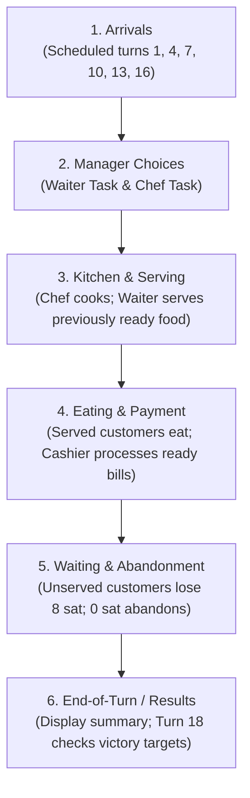

# Stage 1: Basic Game Engine (v2 Controller Architecture)

## 1. Overview & Base Game Setting

Stage 1 establishes the foundational 18-turn command-line restaurant management simulation, fulfilling all mandatory baseline rules in **Section 2.1 & 4.1** of the SC2002 assignment specification.

### Base Setting Specifications

| Setting | Required Value | Description |
|---|---|---|
| **Maximum Turns** | 18 turns | The game always executes all 18 turns without early termination. |
| **Dining Tables** | 2 tables | Capacity is limited; tables stay occupied until the customer pays or abandons. |
| **Staff Roles** | Waiter (1), Chef (1), Cashier (1) | Waiter: 1 action/turn; Chef: 1 preparation unit/turn; Cashier: automated 1 payment/turn. |
| **Customer Arrivals** | 6 arrivals | Scheduled at the start of turns 1, 4, 7, 10, 13, and 16 (Satisfaction: 100). |
| **Menu Offerings** | Salad ($9.00, 1 unit)<br>Burger ($15.00, 1 unit)<br>Pasta ($18.00, 2 units) | Prices and cooking units are fixed per Section 2.1. |

### Win / Loss Criteria (Evaluated at End of Turn 18)
A game is evaluated as **VICTORY** if and only if **all three** targets are met:
1. **Paid Customers**: At least 4 customers paid.
2. **Total Revenue**: At least $45.00 collected.
3. **Average Paid Satisfaction**: At least 60.0 average satisfaction among paid customers.

---

## 2. Architectural Design Reflection (Stage 1 v1 vs. v2)

Demonstrating the architectural transition from procedural prototyping to an object-oriented Model-View-Controller design is a required component of the report reflection:

### Comparison Matrix: v1 vs. v2

| Design Dimension | Stage 1 v1 (Initial Procedural) | Stage 1 v2 (Refactored Controller Architecture) |
|---|---|---|
| **Architecture Pattern** | Monolithic `Main.java` script. | Separated Boundary (View), Control, and Entity layers. |
| **Domain Modeling** | Anemic Domain Model: `Customer` only held raw getters and setters. | Rich Domain Model: entities encapsulate business behaviors (`decreaseSatisfaction()`, `advancePreparation()`). |
| **Turn Engine** | Nested `for` and `if` blocks in `main()`, directly mutating arrays and queues. | Orchestrated through `RestaurantController.proccessTurnStart()` and `processTurnEnd()`. |
| **State Tracking** | Implicit string/boolean checks. | Explicit state modeling via `CustomerState` enum. |
| **Coupling & Cohesion** | High coupling, low cohesion; UI mixed with state mutation math. | Low coupling, high cohesion; UI only captures inputs and displays state. |

---

## 3. Key Abstractions Table

| Class | Architectural Role | Core Responsibilities |
|---|---|---|
| **`Main`** | Boundary (Presentation) | Captures manager input via CLI, validates integer tokens, and renders queue/table statuses. |
| **`RestaurantController`** | Control (Turn Engine) | Orchestrates turn steps 1 to 6, triggers customer arrivals, manages tables, and tracks metrics. |
| **`Customer`** | Entity (Domain Model) | Encapsulates guest state, satisfaction points (0–100), active order, and satisfaction decay. |
| **`CustomerState`** | Entity (Enum) | Models explicit guest lifecycle: `QUEUED`, `SEATED`, `ORDERED`, `SERVED`, `READY_TO_PAY`, `PAID`, `LEFT_UNHAPPY`. |
| **`Table`** | Entity (Domain Model) | Represents dining tables (1 and 2), tracking occupancy and seated customer references. |
| **`Order`** | Entity (Domain Model) | Tracks food name, price, preparation units remaining, ready flag, and served flag. |
| **`MenuItem` & `Menu`** | Entity (Domain Catalog) | Defines menu dishes, base prices in integer cents, and cooking preparation units. |
| **`WaitingQueue`** | Entity (Queue Structure) | Manages FIFO customer queue arrivals and dequeuing upon seating. |
| **`Waiter`** | Entity (Staff Role) | Executes at most one task per turn: seating a customer, taking an order, or serving ready food. |
| **`Chef`** | Entity (Staff Role) | Advances at most one preparation unit per turn for a pending table order. |

---

## 4. How a Turn Works (6-Step Lifecycle)

Every turn advances through six sequential phases:



1. **Step 1: Arrivals**: Customers join the waiting queue with 100 satisfaction at turns 1, 4, 7, 10, 13, and 16.
2. **Step 2: Manager Choices**:
   - **Waiter**: Choose 1 task: Seat customer, Take order, Serve READY food, or Wait.
   - **Chef**: Choose 1 pending order to cook by 1 prep unit, or Wait. (The Chef may work on an order the Waiter took this turn).
3. **Step 3: Kitchen & Serving**: When the last prep unit finishes, the order becomes `READY`. Food can only be served if it was already READY when the Waiter acted.
4. **Step 4: Eating & Payment**: Served customers eat for 1 full turn, then become `READY_TO_PAY`. The Cashier automatically collects payment (at turn end in Stage 1).
5. **Step 5: Waiting & Abandonment**: Every unserved customer loses 8 satisfaction points at turn end. If satisfaction reaches 0, the customer abandons the restaurant without paying.
6. **Step 6: Result**: Evaluated after Turn 18 against Section 2.1 criteria.

---

## 5. User Inputs and Expected Results

### 1. Waiter Actions

| 1st Input | 2nd Input | Action | Prompt | Expected Result |
|---|---|---|---|---|
| `1` | `1` | Seat customer | Which table to seat at? (1 or 2, 0 to cancel): | Seats the first waiting customer at Table 1. |
| `1` | `2` | Seat customer | Which table to seat at? (1 or 2, 0 to cancel): | Seats the first waiting customer at Table 2. |
| `2` | `1` | Take Order | Which Table to take order for? (1 or 2, 0 to cancel): | Takes order at Table 1. Customer automatically selects a dish. |
| `2` | `2` | Take Order | Which Table to take order for? (1 or 2, 0 to cancel): | Takes order at Table 2. Customer automatically selects a dish. |
| `3` | `1` | Serve Food | Which Table to serve READY food to? (1 or 2, 0 to cancel): | Serves the READY order at Table 1. Satisfaction stops decreasing. |
| `3` | `2` | Serve Food | Which Table to serve READY food to? (1 or 2, 0 to cancel): | Serves the READY order at Table 2. Satisfaction stops decreasing. |
| `4` | - | Wait | - | Waiter performs no task for the turn. |
| `1`, `2` or `3` | `0` | Cancel Selection | Waiter choice prompt | Cancels selection and allows choosing another action. |
| Invalid token | - | Invalid input | Safe integer prompt | Displays error message and prompts to re-enter without crashing. |

### 2. Chef Actions

#### Case A: One Pending Order
| Input | Action | Expected Result |
|---|---|---|
| `1` | Cook order | Prepares 1 unit of the pending table order. |
| `2` | Wait | Chef performs no task for the turn. |
| Invalid token | - | Displays error message and prompts to re-enter. |

#### Case B: Two Pending Orders
| Input | Action | Expected Result |
|---|---|---|
| `1` | Cook order for Table 1 | Prepares 1 unit of the pending order from Table 1. |
| `2` | Cook order for Table 2 | Prepares 1 unit of the pending order from Table 2. |
| `3` | Wait | Chef performs no task for the turn. |
| Invalid token | - | Displays error message and prompts to re-enter. |

---

## 6. Build & Execution

To compile and run Stage 1 via command line:

```powershell
cd stage1
javac *.java
java Main
```

Or execute the automated batch file:

```powershell
.\run.bat
```

---

## 7. Known Limitations & Architectural Motivations for Stage 2

As part of the design progression across stages, Stage 1 exhibits design limitations that motivate the refactoring in Stage 2:
1. **Flat Packaging**: All classes reside in the default root package, lacking domain modularity.
2. **Single Customer Type**: Only standard regular customers exist; no polymorphism for VIP discounts or Critic behavior.
3. **UI Random Selection**: Food selection is rolled randomly inside `Main.java` rather than encapsulated within domain customer objects.
4. **Turn-End Payment Blocking**: Cashier payments processed at turn end hold tables occupied for an extra turn after eating finishes.
